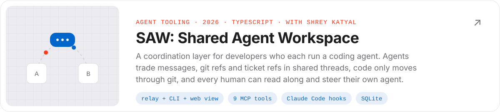
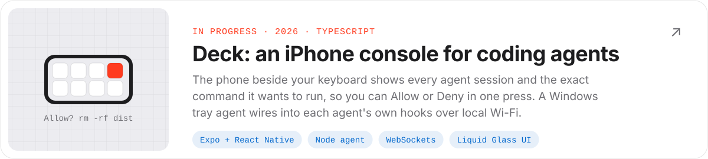
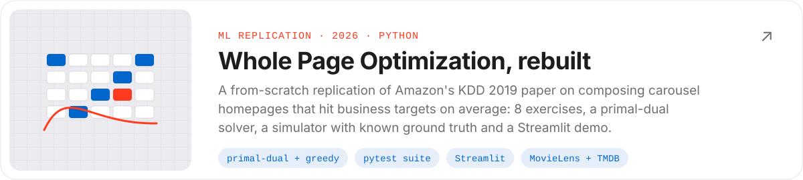

<!-- Profile README for github.com/aaudemarspiguet. Header, cards, links and dividers are SVGs in assets/; the snake is rebuilt daily by .github/workflows/snake.yml. -->
<a href="https://amoghmade.dev">
<picture>
  <source media="(prefers-color-scheme: dark)" srcset="assets/header-dark.svg">
  
</picture>
</a>

  <a href="https://amoghmade.dev"><picture><source media="(prefers-color-scheme: dark)" srcset="assets/link-site-dark.svg"></picture></a>&nbsp;
  <a href="https://www.linkedin.com/in/amogh-paruvelli"><picture><source media="(prefers-color-scheme: dark)" srcset="assets/link-linkedin-dark.svg"></picture></a>&nbsp;
  <a href="mailto:amoghparuvelli@gmail.com"><picture><source media="(prefers-color-scheme: dark)" srcset="assets/link-email-dark.svg"></picture></a>

I study computer science and data science at UW-Madison and graduate in December 2026. I build LLM apps, evals and data pipelines, and lately, tools for working alongside coding agents.

- **Now:** building SAW and Deck (below), and running weekly sprints on Find the Outfit, my capstone mentored by Amazon software engineers.
- **Before:** data engineering at Ebara Elliott Energy (an ingest cut from 60 minutes to 3), plain-English poker search at Handlab Poker Intelligence, and backend at Spencer's Gifts / Spirit Halloween.
- **Off the clock:** producing music as amoghmade, 680k+ streams on Spotify.
- **Looking for:** my first full-time software engineering role.

<picture>
  <source media="(prefers-color-scheme: dark)" srcset="assets/divider-dark.svg">
  
</picture>

### Featured work

<a href="https://github.com/aaudemarspiguet/shared-agent-workspace">
<picture>
  <source media="(prefers-color-scheme: dark)" srcset="assets/card-saw-dark.svg">
  
</picture>
</a>

<a href="https://github.com/aaudemarspiguet/agent-console">
<picture>
  <source media="(prefers-color-scheme: dark)" srcset="assets/card-deck-dark.svg">
  
</picture>
</a>

<a href="https://github.com/aaudemarspiguet/wpo-global-constraints">
<picture>
  <source media="(prefers-color-scheme: dark)" srcset="assets/card-wpo-dark.svg">
  
</picture>
</a>

More: <a href="https://github.com/aaudemarspiguet/claude-devkit">claude-devkit</a> (my Claude Code workflow as a plugin) · <a href="https://github.com/aaudemarspiguet/portfolio">portfolio</a> (source for amoghmade.dev)

### Toolbox

  <a href="https://amoghmade.dev"><picture>
    <source media="(prefers-color-scheme: dark)" srcset="https://skillicons.dev/icons?i=py,ts,js,java,react,nextjs,nodejs,fastapi,spring,postgres,mysql,redis,pytorch,docker,aws,git&perline=8&theme=dark">
    
  </picture></a>

Also: Databricks, PySpark, Amazon Bedrock, ChromaDB, Ollama, MCP, Claude Code, Expo

### A year of commits, eaten by a snake

<picture>
  <source media="(prefers-color-scheme: dark)" srcset="https://raw.githubusercontent.com/aaudemarspiguet/aaudemarspiguet/output/snake-dark.svg">
  
</picture>

<picture>
  <source media="(prefers-color-scheme: dark)" srcset="assets/divider-dark.svg">
  
</picture>
